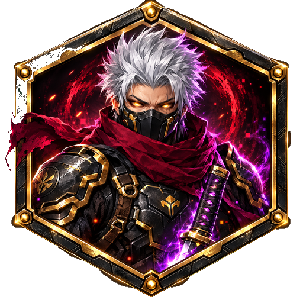
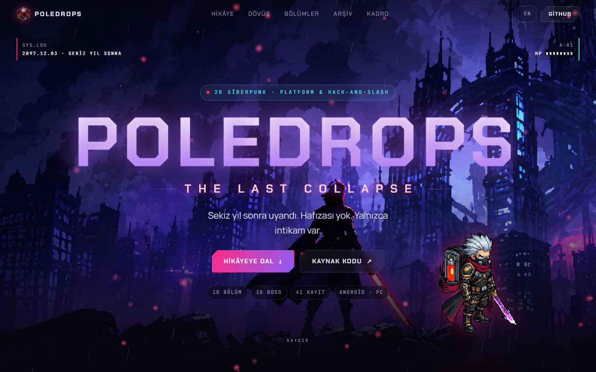
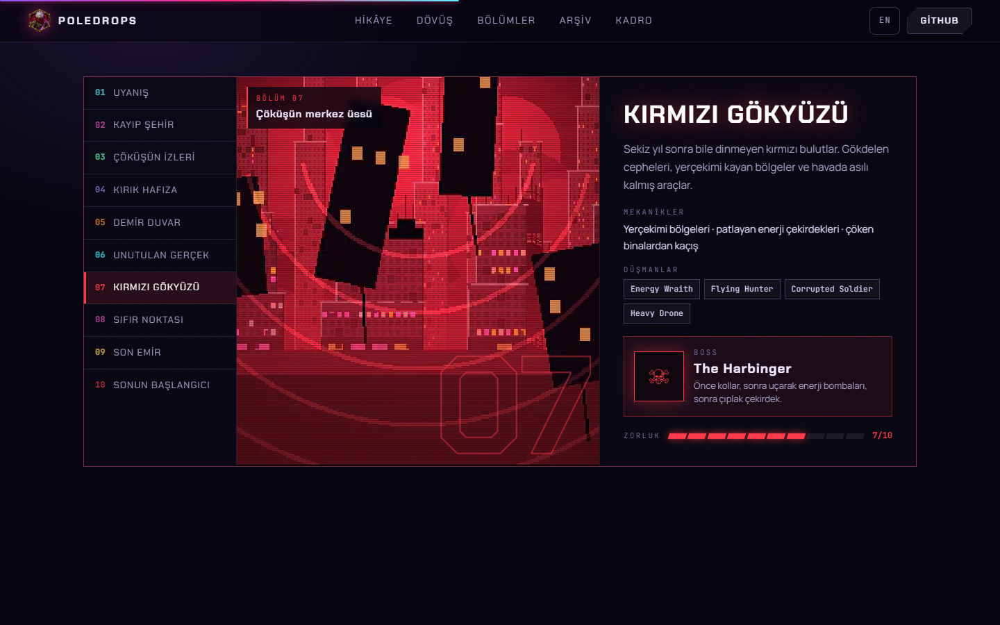
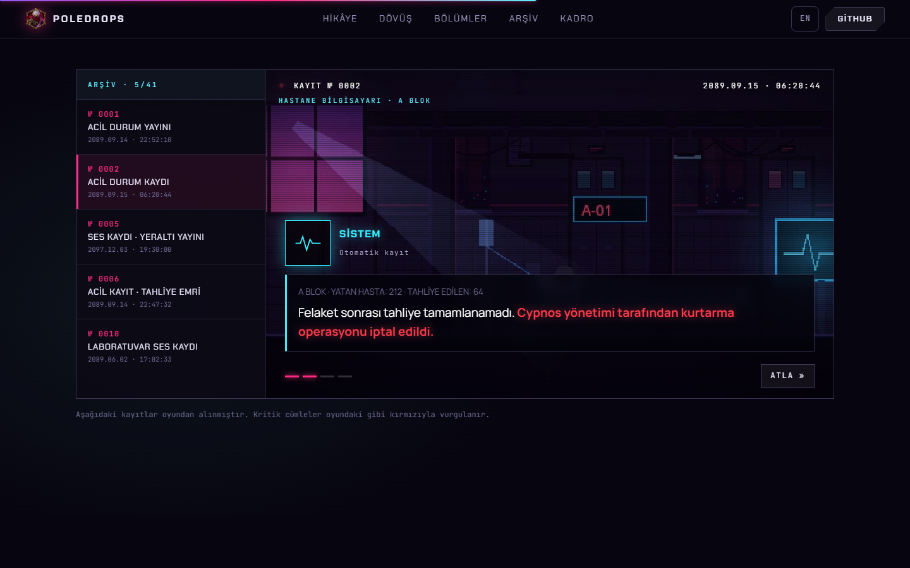
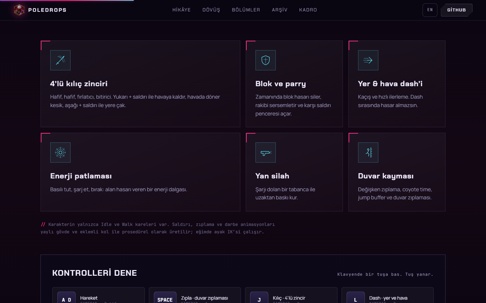
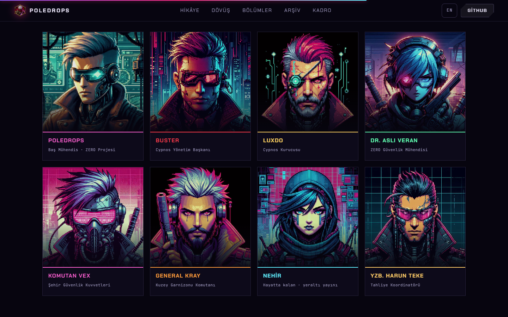
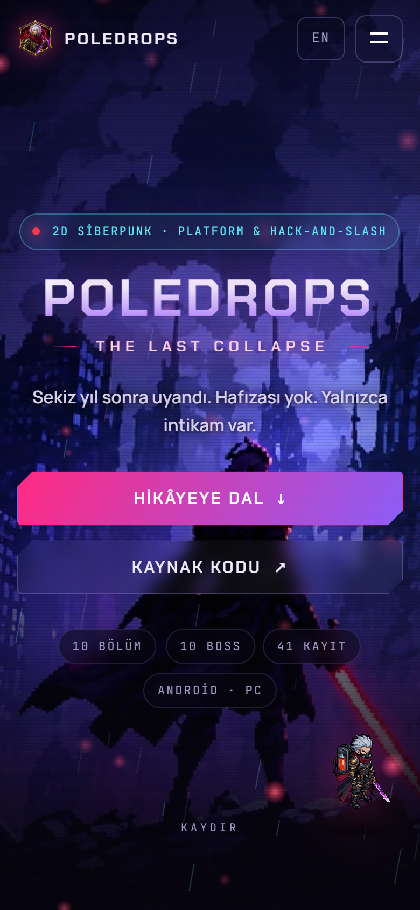

<div align="center">



# POLEDROPS: THE LAST COLLAPSE
### Resmî tanıtım sitesi

Sekiz yıl sonra uyanan bir mühendisin intikam hikâyesi. 2D siberpunk platform ve kılıç dövüşü.

[](https://poledrops.github.io/Poledrops_The_Last_CollapseSite/)
[](https://github.com/Poledrops/Poledrops_The_Last_Collapse)


[](https://github.com/Poledrops/Poledrops_The_Last_CollapseSite/actions/workflows/deploy.yml)



</div>

---

## İçindekiler

- [Proje hakkında](#proje-hakkında)
- [Öne çıkanlar](#öne-çıkanlar)
- [Ekran görüntüleri](#ekran-görüntüleri)
- [Teknoloji](#teknoloji)
- [Başlarken](#başlarken)
- [Proje yapısı](#proje-yapısı)
- [İçeriği düzenleme](#içeriği-düzenleme)
- [Yayınlama (GitHub Pages)](#yayınlama-github-pages)
- [Erişilebilirlik ve performans](#erişilebilirlik-ve-performans)
- [Krediler ve lisanslar](#krediler-ve-lisanslar)
- [English summary](#english-summary)

## Proje hakkında

Bu depo, [Poledrops: The Last Collapse](https://github.com/Poledrops/Poledrops_The_Last_Collapse) oyununun tanıtım sitesidir. Site, oyunun kendi sanatını (başlık ekranı, kayıt sahneleri, karakter portreleri, piksel sprite) kullanır ve oyunun görsel diline sadık kalır: koyu mor, lacivert, kırmızı ve neon pembe.

Oyunun kendisi Godot 4.7 ile, yalnızca GDScript kullanılarak yazılmıştır. Hikâye anlatıcı kutularla değil, oyun boyunca bulunan 41 sinematik kayıtla anlatılır. Site bu fikri arşiv bölümünde canlı olarak gösterir.

## Öne çıkanlar

| Bölüm | Ne sunuyor |
|---|---|
| **Hero** | Parallax başlık ekranı, yağmur ve kıvılcım parçacıkları, glitch'li başlık, idle animasyonlu karakter |
| **Hikâye** | Kaydırmayla beliren satırlar, sayaçlar, CRT çerçeveli sahne |
| **Dövüş** | Altı yetenek kartı ve **etkileşimli kontrol paneli**: klavyende bir tuşa bas, tuş yanar |
| **Bölümler** | 10 bölümün her biri için sahne, mekanikler, düşmanlar, boss ve zorluk çubuğu |
| **Arşiv** | Oyundaki kayıt ekranını taklit eden **daktilo efektli oynatıcı**; kritik cümleler oyundaki gibi kırmızı |
| **Kadro** | 12 karakter portresi, fareyle eğilen kartlar |
| **Teknik** | Oyunun mühendislik özellikleri |

Ek olarak:

- Türkçe ve İngilizce arayüz; tarayıcı diline göre otomatik seçilir ve hatırlanır
- Telefon, tablet ve masaüstü için duyarlı tasarım (çentikli ekranlar için güvenli alan desteği dahil)
- Okuma ilerleme çubuğu, imleç ışığı, ekran dışında duran animasyonları durduran parçacık sistemi
- Tamamen statik çıktı: sunucu gerekmez

## Ekran görüntüleri

<table>
  <tr>
    <td width="50%"><br/><sub><b>Bölüm gezgini</b>: 10 bölüm, boss ve zorluk</sub></td>
    <td width="50%"><br/><sub><b>Sinematik arşiv</b>: oyundan birebir kayıtlar</sub></td>
  </tr>
  <tr>
    <td width="50%"><br/><sub><b>Dövüş</b>: yetenek kartları ve kontrol paneli</sub></td>
    <td width="50%"><br/><sub><b>Kadro</b>: kayıt ekranı portreleri</sub></td>
  </tr>
</table>

<div align="center">
  <br/>
  <sub><b>Mobil görünüm</b></sub>
</div>

## Teknoloji

- **[React 18](https://react.dev/)**: arayüz
- **[Vite 5](https://vitejs.dev/)**: geliştirme sunucusu ve üretim derlemesi
- **[Framer Motion](https://www.framer.com/motion/)**: kaydırma ve giriş animasyonları
- **Saf CSS**: tasarım jetonları, `clamp()` ile akışkan tipografi, `color-mix()`, CRT/tarama çizgisi efektleri
- **Canvas 2D**: yağmur ve kıvılcım parçacıkları
- **GitHub Actions + GitHub Pages**: otomatik yayın

Çalışma zamanı bağımlılığı yalnızca `react`, `react-dom` ve `framer-motion`'dır. Paket boyutu yaklaşık 104 kB (gzip).

## Başlarken

Gereksinim: [Node.js](https://nodejs.org/) 20 veya üstü.

```bash
git clone https://github.com/Poledrops/Poledrops_The_Last_CollapseSite.git
cd Poledrops_The_Last_CollapseSite
npm install
npm run dev
```

Geliştirme sunucusu `http://localhost:5173` adresinde açılır.

| Komut | Açıklama |
|---|---|
| `npm run dev` | Sıcak yenilemeli geliştirme sunucusu |
| `npm run build` | `dist/` klasörüne üretim derlemesi |
| `npm run preview` | Derlenmiş siteyi yerelde önizleme |

## Proje yapısı

```text
.
├── .github/workflows/deploy.yml   GitHub Pages yayın akışı
├── docs/screenshots/              README görselleri
├── public/assets/
│   ├── ui/                        logo, başlık ekranı
│   ├── scenes/                    20 kayıt sahnesi (piksel sanatı)
│   ├── portraits/                 12 karakter portresi
│   └── sprite/                    ana karakter idle kareleri
├── src/
│   ├── content.js                 tüm metinler (TR/EN), bölümler, kadro, kayıtlar
│   ├── lang.jsx                   dil bağlamı
│   ├── fx.jsx                     Reveal, CountUp, kırmızı vurgu ayrıştırıcı
│   ├── Particles.jsx              canvas yağmur ve kıvılcım
│   ├── components/                Hero, Story, Combat, Levels, Archive, Cast…
│   └── styles.css                 tüm stiller
├── index.html
└── vite.config.js                 base: './' (alt klasörde yayın için)
```

## İçeriği düzenleme

Metinlerin tamamı tek dosyada: [`src/content.js`](src/content.js).

- **Bölüm eklemek/değiştirmek:** `LEVELS` dizisi (her bölüm `tr` ve `en` metni, sahne, renk, boss, düşmanlar)
- **Arşive kayıt eklemek:** `RECORDS` dizisi. Kırmızı vurgulanacak cümleyi `{süslü parantez}` içine al; konuşmacılar `SPEAKERS` içinde tanımlıdır
- **Karakter eklemek:** `CAST` dizisi ve `public/assets/portraits/` içine ilgili `.webp`
- **Kontrol tuşları:** `KEYS` dizisi
- **GitHub bağlantısı:** dosyanın başındaki `GITHUB` sabiti

Renkler ve boşluklar `src/styles.css` içindeki `:root` jetonlarından gelir.

## Yayınlama (GitHub Pages)

`main` dalına her push, [`deploy.yml`](.github/workflows/deploy.yml) iş akışını çalıştırır: bağımlılıkları kurar, siteyi derler ve `dist/` çıktısını GitHub Pages'e yayınlar.

Canlı adres: **https://poledrops.github.io/Poledrops_The_Last_CollapseSite/**

Vite `base: './'` ile yapılandırıldığı için site herhangi bir alt klasörde (veya özel alan adında) ek ayar gerektirmeden çalışır.

## Erişilebilirlik ve performans

- `prefers-reduced-motion` açıksa animasyonlar, parçacıklar ve kayan şerit devre dışı kalır
- Odak halkaları, klavyeyle gezilebilir bölüm sekmeleri (ok tuşları) ve `aria` etiketleri
- Parçacık sistemi ekran dışındayken çizimi durdurur
- Görseller WebP; piksel sanatı `image-rendering: pixelated` ile keskin gösterilir
- Dokunmatik cihazlarda fareye bağlı efektler kapalıdır

## Krediler ve lisanslar

Bu sitenin kaynak kodu (`src/`) ve içeriği yazara aittir; bir açık kaynak lisansı seçilene kadar tüm hakları saklıdır. Sitede kullanılan üçüncü taraf varlıkların kendi lisansları geçerlidir:

- **Karakter sprite'ları**: elie automata, ücretsiz lisans (kredi şartıyla kullanım; orijinal veya değiştirilmiş varlıkların tek başına yeniden dağıtımı yasak)
- **Ortam sanatı**: ansimuz (Luis Zuno), knekko, Eris. Ayrıntılar için oyun deposundaki `docs/ASSET_LICENSES.md`
- **PixelFX**: MIT
- **Yazı tipleri** ([Google Fonts](https://fonts.google.com/)): Chakra Petch, Manrope, JetBrains Mono, Press Start 2P (SIL OFL)
- **Oyun motoru**: [Godot Engine](https://godotengine.org/), MIT

Portreler ve sahne görselleri oyunun kendi üretimidir ve yalnızca bu oyunun tanıtımı için kullanılır.

## English summary

The official promo site for **Poledrops: The Last Collapse**, a 2D cyberpunk platformer and hack-and-slash built in Godot 4.7. Built with React 18, Vite and Framer Motion; fully static, responsive, bilingual (TR/EN) and deployed to GitHub Pages through GitHub Actions.

```bash
npm install
npm run dev      # http://localhost:5173
npm run build    # static output in dist/
```

Highlights: a parallax hero, an interactive controls panel, a 10-level explorer with bosses and difficulty, and a typewriter-style recreation of the game's in-world record player. All copy lives in `src/content.js`.

Live site: https://poledrops.github.io/Poledrops_The_Last_CollapseSite/

---

<div align="center">
  <sub>Çöküşün külleri üzerinde, elle işlendi.</sub>
</div>
